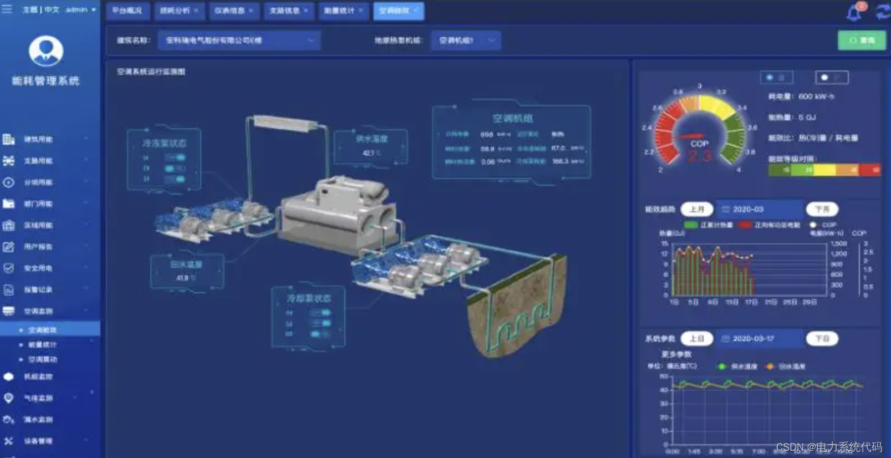
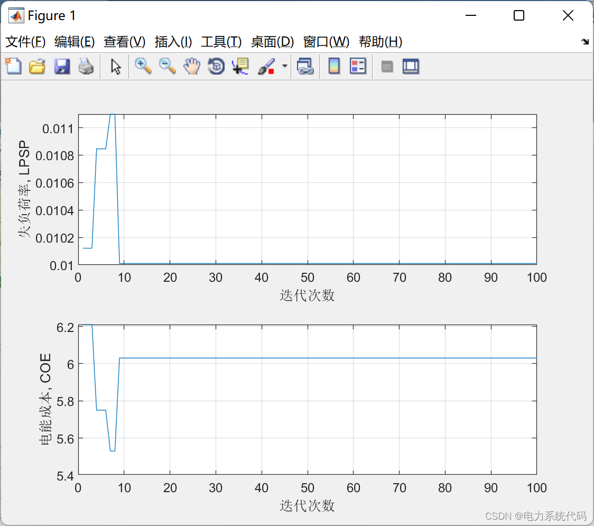
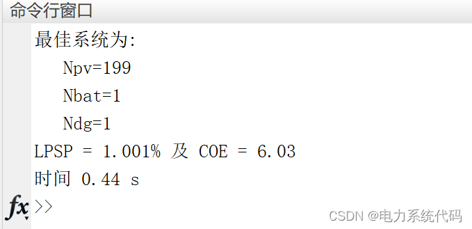

# Energy Management System (EMS) based on Particle Swarm Optimization, considering photovoltaic, energy storage, and diesel engine systems

The construction of EMS will play a significant role in the reform of the energy management system. One of its fundamental objectives is to achieve simplified energy operation management, reduce the labor input in daily management, save human resource costs, and improve labor productivity.
EMS can quickly understand the system's operational status and the impact of faults from a global perspective, take timely system measures to limit the further expansion of the fault scope, and effectively restore the normal operation of the system.
Editor
2 Operational Results
Editor
3 MATLAB Code Implementation
This article only showcases part of the code, all codes are available in:
%% Visualization results\nfor n_ite=1:set.Niteration\n    LPSP(n_ite)=log_global(n_ite).LPSP;\n    COE(n_ite)=log_global(n_ite).COE;\nend\nsubplot(2,1,1);\nplot(LPSP);\ngrid on;\nxlabel('Iteration count')\nylabel('Loss of load factor, LPSP');\n\nsubplot(2,1,2);\nplot(COE);\ngrid on;\nxlabel('Iteration count')\nylabel('Electricity cost, COE');\n\ntpro=toc;\n  
4. End Note: The theoretical references in this section are from online literature, and if there is any copyright infringement, please contact the blogger to delete it.

## Images

<!-- PAYMENT_BLOCK -->

## Get this dataset

- Payment link (Stripe): [Buy now](https://buy.stripe.com/3cs8yP7sY87d0vu9AB)
- Payment QR code: 

<!-- /PAYMENT_BLOCK -->
